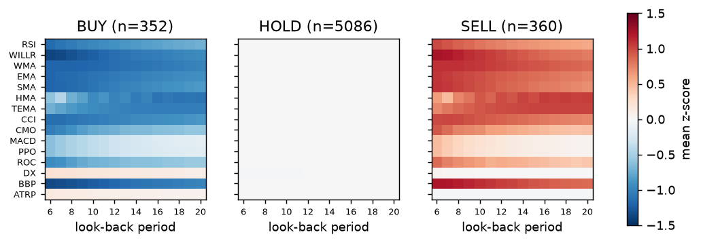
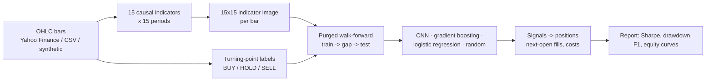
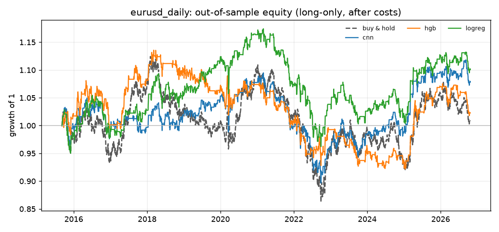
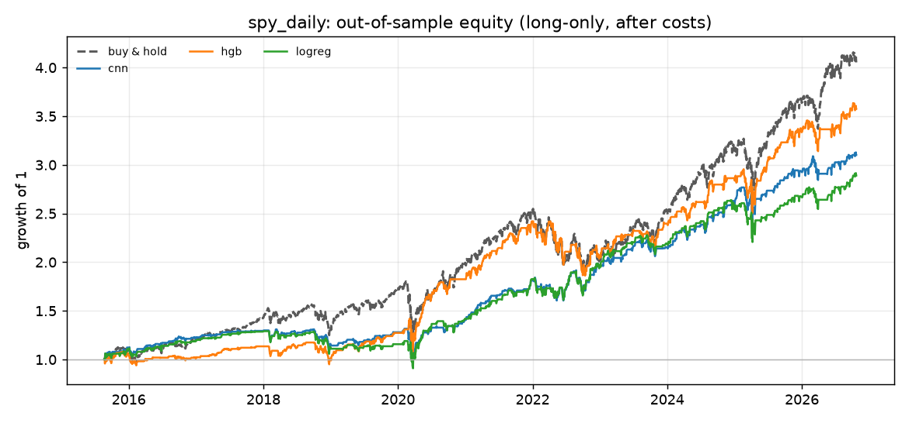

# CNN Trading Signals

[](https://github.com/vishal-thalla/cnn-trading-signals/actions/workflows/ci.yml)


Can a convolutional network read technical indicators as an *image* and call market turning points well enough to trade them, **after costs, on data it has never seen?**

This repository is a research pipeline that tests that question rigorously. Each price bar becomes a 15 × 15 "indicator image": 15 technical indicators × 15 look-back periods. Each bar is labelled BUY / HOLD / SELL by whether it is a local low or high. A PyTorch CNN is trained on those images and compared with simpler models and a random baseline. Testing uses **purged walk-forward validation** and a backtester that **fills at the next bar's open and charges spread and commission**.

> **Headline result:** Across six experiments (11 years of daily out-of-sample data and one year of hourly data), all three models find turning points far better than chance. None of them turns that into a trading edge that clearly beats random strategies after costs. The CNN was also the weakest classifier every time: gradient boosting on the same images beat it by 0.04–0.11 macro-F1.



*Average indicator image for each label on USD/JPY daily bars (each cell z-scored against all bars). BUY bars look oversold, SELL bars look overbought. The CNN learns this pattern. The hard part is that half of each label is decided by bars that have not happened yet.*

## Pipeline



| Stage | Module | What it does |
|---|---|---|
| Data | `data.py` | Yahoo Finance (cached), any OHLC CSV, or a seeded synthetic random walk for credentials-free runs |
| Features | `indicators.py`, `imaging.py` | RSI, Williams %R, WMA/EMA/SMA/HMA/TEMA distance, CCI, CMO, MACD, PPO, ROC, DX, Bollinger %B, ATR%. All are vectorised pandas with no TA-Lib, normalised to about [-1, 1] and computed for periods 6–20 |
| Labels | `labeling.py` | A bar is BUY or SELL if it is the lowest or highest close of the centred *w*-bar window |
| Validation | `splits.py` | Expanding (or rolling) walk-forward. Each test fold is preceded by a purge gap equal to the label horizon (`w // 2` bars), plus an optional embargo |
| Models | `models.py` | A 2-conv-layer PyTorch CNN with class-weighted loss and early stopping on a chronological validation slice. Also scikit-learn gradient boosting, logistic regression, and prior/random no-skill baselines |
| Backtest | `backtest.py`, `metrics.py` | Long-only and long/short. A decision made at the close of bar *t* fills at the open of *t + 1*, and costs are charged per unit of turnover. Reports CAGR, Sharpe, Sortino, max drawdown, Calmar, trades, win rate and exposure |
| CLI | `cli.py` | `cts run <config>` writes `summary.json`, `results.md`, predictions, equity CSV and charts |

## Results

All runs use the configs in [`configs/`](configs), six purged walk-forward folds over the second half of each history, 1 bp cost per unit turnover, and arg-max signals. Every setting was fixed before any out-of-sample run. Each cell shows **macro-F1 / long-only Sharpe (percentile against 200 random strategies with the same class mix)**. A random classifier scores about 0.33 macro-F1.

| Market | Out-of-sample | Buy & hold Sharpe | Random long-only Sharpe, 5th–95th pct. | CNN | Gradient boosting | Logistic regression |
|---|---|---:|---:|---:|---:|---:|
| USD/JPY daily | 2015-09 – 2026-10 | 0.30 | -0.17 to 0.57 | 0.47 / 0.23 (56th) | 0.57 / 0.05 (26th) | 0.55 / 0.08 (30th) |
| EUR/USD daily | 2015-09 – 2026-10 | 0.05 | -0.33 to 0.27 | 0.45 / 0.15 (80th) | 0.56 / 0.06 (64th) | 0.54 / 0.18 (84th) |
| GBP/USD daily | 2015-08 – 2026-10 | -0.09 | -0.45 to 0.27 | 0.46 / -0.02 (62nd) | 0.57 / -0.08 (52nd) | 0.54 / 0.05 (74th) |
| SPY daily | 2015-08 – 2026-10 | 0.80 | 0.24 to 0.89 | 0.42 / 0.78 (86th) | 0.52 / 0.81 (88th) | 0.46 / 0.72 (82nd) |
| USD/JPY hourly | 2025-11 – 2026-10 | 0.29 | -1.15 to 1.08 | 0.43 / -0.31 (38th) | 0.48 / -0.62 (24th) | 0.45 / -0.90 (12th) |
| EUR/USD hourly | 2025-11 – 2026-10 | -0.40 | -1.79 to 0.43 | 0.45 / -0.81 (45th) | 0.49 / -0.66 (52nd) | 0.46 / -0.33 (72nd) |

Full tables (total return, CAGR, drawdown, trades, win rate, exposure, long/short) are in [docs/RESULTS.md](docs/RESULTS.md). Every run also writes `summary.json`, predictions and equity curves to `reports/<name>/`.

**What the numbers say**

1. **The labels are learnable, but that is not the same as predictable.** All models reach 0.42–0.57 macro-F1. The class-average image above shows why: a BUY bar looks oversold *so far*. Whether price keeps falling for the next `w/2` bars, which decides the label, is the part the image cannot show.
2. **The CNN did not beat simpler models.** On identical 15×15 inputs, gradient boosting and logistic regression beat it on macro-F1 in all six experiments. The image layout adds little that a flat feature vector does not already provide.
3. **No result is clearly better than chance after costs.** No model's long-only Sharpe beats the 95th percentile of the random strategies. The best is 88th (gradient boosting on SPY). On EUR/USD and GBP/USD the models beat a flat buy & hold, but random strategies did about as well.
4. **The one useful effect is risk, not return.** On SPY the long-only models matched buy & hold's Sharpe (0.72–0.81 against 0.80) while invested only 40–60% of the time, with smaller drawdowns (−23.7% to −29.6% against −34.1%). They also made less money.
5. **Hourly bars are worse.** Turning points 12 bars ahead are noisy, and costs eat a larger share of each move.




A negative result reached with a sound method is still the result. The value of this repository is the evaluation harness. Plug in a different feature set, label or model through the config, and it reports whether the change survives purging, next-bar fills, costs and a random benchmark.

## Engineering decisions that matter

- **No look-ahead in features.** Every indicator is causal. Tests change future bars and assert that past images are unchanged, for every indicator.
- **Label leakage is purged.** A turning-point label at bar *t* uses closes up to *t + w/2*. Without a purge gap, the last training rows of each fold would contain information from the test window.
- **No trading at the price used to decide.** Signals fill at the next open. Turnover pays half the spread plus commission, so a reversal pays double.
- **Baselines are part of the experiment.** Any CNN result is compared with buy & hold, a linear model, gradient boosting and the Sharpe distribution of 200 random strategies with each fold's class mix. One random run is too noisy to compare against, and a model that beats buy & hold over one lucky period is not evidence of skill.
- **Hyper-parameters were fixed before testing.** Label window, confidence threshold (pure arg-max), costs and model settings were chosen before looking at out-of-sample results, so the reported tables are not the best of many tries.
- **Tested.** The suite has 64 tests. They cover indicator reference values (including a hand-rolled Wilder RSI), causality, label edge cases, fold purging, fill prices, cost arithmetic and an end-to-end CLI run. CI runs lint and tests on Python 3.11–3.13.

## Quick start

```bash
git clone https://github.com/vishal-thalla/cnn-trading-signals && cd cnn-trading-signals
python -m venv .venv && source .venv/bin/activate
pip install torch --index-url https://download.pytorch.org/whl/cpu   # or a CUDA build
pip install -e ".[data,dev]"

pytest                                             # 64 tests
cts run configs/quickstart_synthetic.yaml          # no network needed
cts -v run configs/usdjpy_daily.yaml               # downloads and caches Yahoo data
cts images configs/usdjpy_daily.yaml --out docs/class_images.png
```

To use your own data, point a config at a CSV with `datetime, open, high, low, close` columns:

```yaml
name: my_experiment
interval: 1h                     # used to annualise metrics
data: {type: csv, path: data/my_bars.csv}
label_window: 25                 # odd; label horizon = window // 2
folds: 6
min_train_fraction: 0.5
spread_bps: 1.0
commission_bps: 0.5
models:
  - name: cnn
    params: {epochs: 60, patience: 8}
  - name: hgb
```

## Limitations

- Yahoo Finance FX bars are indicative mid quotes, not executable prices. Daily FX bars there often have `open == close`. Treat absolute numbers as approximate and the *comparison between models* as the result.
- Costs are a flat per-turnover charge. Slippage, swap/financing and borrow costs are not modelled.
- One seed per run (varied per fold). CNN results move a little between seeds (`cts run ... --seed N`).
- Each run covers a single instrument. Pooling instruments or adding cross-asset features is a natural next step.

## Background and credits

This is a ground-up rebuild of **trading-bot-v2**, a 2023–24 side project by Vishal Thalla. That project explored Alpaca and OANDA trading bots and, later, a CNN over TA-Lib indicator images for OANDA FX pairs. The rebuild keeps the core idea and the original CNN architecture. It replaces TA-Lib and SQLite with tested, vectorised NumPy/pandas. It also adds purged walk-forward validation, a realistic cost-aware backtester, baselines, a config-driven CLI and CI.

The image-encoding idea comes from O. B. Sezer and A. M. Ozbayoglu, *"Algorithmic financial trading with deep convolutional neural networks: Time series to image conversion approach"*, Applied Soft Computing 70 (2018). Purging follows M. López de Prado, *Advances in Financial Machine Learning* (2018), ch. 7.

This is research code, not investment advice, and it does not place orders.

## License

MIT. See [LICENSE](LICENSE).
